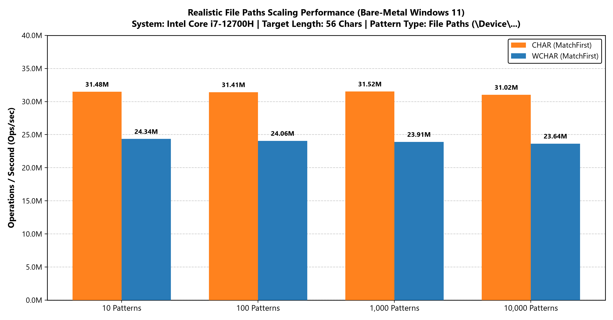
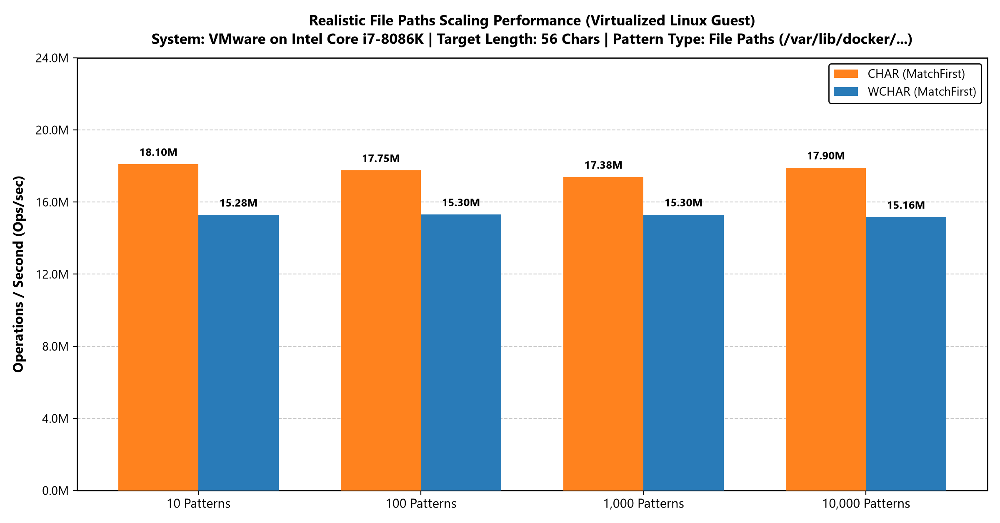
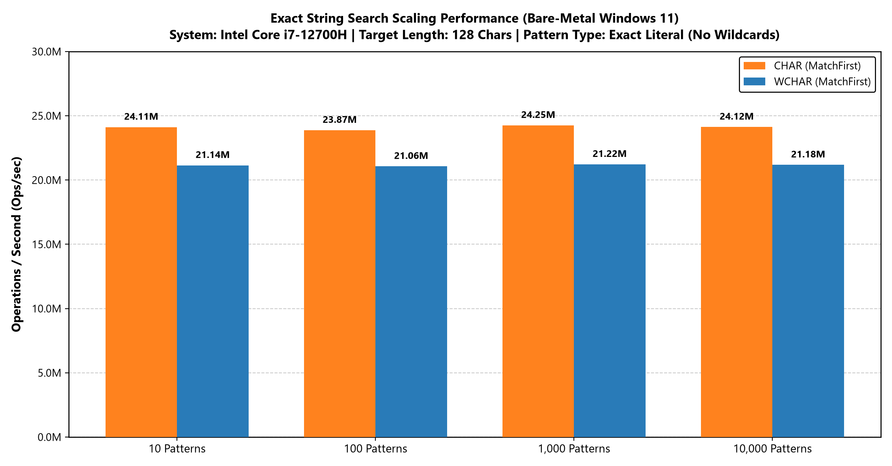
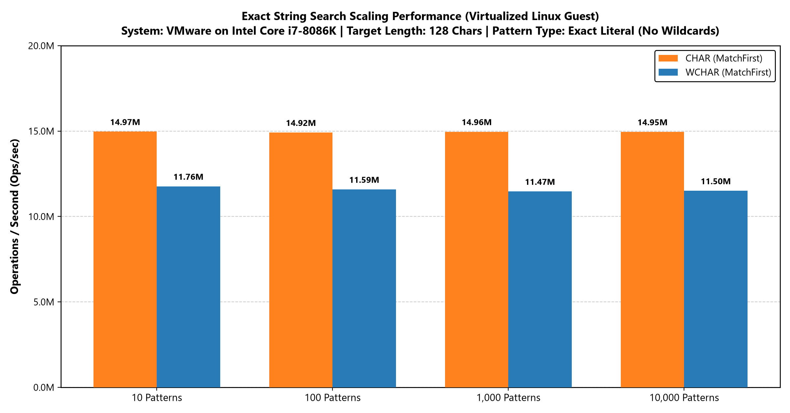

# High-Performance String Pattern Match Engine

-blue)


## Table of Contents
1. [Overview](#overview)
2. [Architecture & Algorithms](#architecture--algorithms)
3. [Quick Start API Overview](#quick-start-api-overview)
   * [Pattern Syntax & Wildcard Scoping](#pattern-syntax--wildcard-scoping)
   * [Template Parameters](#template-parameters)
   * [Public API Methods](#public-api-methods)
   * [Example Implementation](#example-implementation)
4. [Benchmarks & Scaling Performance](#benchmarks--scaling-performance)
   * [Test Methodology & Benchmark Architecture](#test-methodology--benchmark-architecture)
   * [Performance Results](#performance-results)
   * [Toolchain Comparison: GCC vs. Clang (Linux on i7-8086K)](#toolchain-comparison-gcc-vs-clang-linux-on-i7-8086k)
   * [Scaling Analysis](#scaling-analysis)
5. [Project Layout](#project-layout)
6. [Building Test Code](#building-test-code)
   * [Windows (Visual Studio 2026)](#windows-visual-studio-2026)
   * [Linux / macOS (CMake & build.sh)](#linux--macos-cmake--buildsh)
   * [Unicode Case-Folding Test (/unicode_match_sample)](#unicode-case-folding-test-unicode_match_sample)
7. [Conclusion](#conclusion)
8. [License](#license)

---

## Overview

`StringPatternMatch` is a non-blocking, multi-pattern string matching engine designed for high-throughput string filtering, telemetry ingestion, path routing, and rule evaluation in user-space applications. Evaluating candidate strings one pattern at a time via sequential loops or traditional regular expression engines introduces substantial processing latency as rule sets grow. This engine evaluates incoming target strings against a pool of registered patterns simultaneously using prefix grouping, rolling polynomial hashing, an L1 register-blocked existence filter, and non-recursive state machines.

To support file system filtering and path routing across platforms, the engine natively implements path segment scoping (`WildcardScope::PathSegment`), which prevents wildcard expansion from crossing operating-system-specific directory separator boundaries (`\` on Windows, `/` on POSIX systems).

### Key Architectural Highlights
* **Multi-Pattern Matching & Early-Exit:** Indexes patterns concurrently across prefix length groups, evaluating target text against the registered rules in a single pass while using multi-level bitmask and hash filters to discard non-matching inputs early.
* **SIMD Hardware Acceleration & Dynamic Dispatch:** Dynamically evaluates CPU capabilities at runtime on x86/x64 systems via CPUID and OSXSAVE to dispatch optimal SIMD backends (AVX-512, AVX2, or SSE4.1). It uses native 128-bit NEON instructions on ARM architectures and provides a portable scalar fallback path.
* **Allocation-Free Matching Path:** Following pattern registration, the engine performs no internal heap allocations during candidate evaluation. (The caller-provided output vector used for multi-match collection may allocate memory as it expands).
* **Lock-Free Read-Copy-Update (RCU) Concurrency:** The engine intentionally avoids internal read/write locks to preserve multi-GB/s SIMD cache throughput. Concurrent updates are achieved via atomic pointer swaps (RCU), ensuring zero contention on the read path.
* **L1 Register-Blocked Existence Filter:** Implements a fixed 4 KB (`uint64_t[512]`, 32,768-bit) L1-resident existence filter array (`m_hashFilter`) using Fibonacci hashing to instantly reject non-matching candidate prefix hashes before accessing hash map memory buckets.
* **64-Bit SWAR Prefix Signatures & Anchored Tail Filtering:** Extracts 64-bit SIMD Within A Register (SWAR) prefix signatures for $O(1)$ mismatch rejection, paired with anchored trailing literal checks. Pure ASCII blocks under built-in ASCII and Unicode case-folding policies are folded in parallel using bitwise SWAR arithmetic.
* **Non-Recursive State Machine:** Wildcard evaluation relies on an iterative, non-recursive state machine with bounds-checked fast-forward linear scanning (`std::memchr`/`std::wmemchr`, 64-bit SWAR scanning, and unrolled scalar fallback), eliminating recursive stack growth and avoiding stack exhaustion on complex or pathological inputs.
* **Policy-Based Normalization:** Decouples casing and validation logic through C++20 concepts, supporting case-sensitive binary matching, 7-bit ASCII case-folding, wide Unicode case-folding, and user-supplied transformation functors.
* **Dual API Interfaces:** Exposes dual interfaces across all registration and query routines, accepting either modern `std::basic_string_view` instances or raw pointer and character-length pairs.

---

## Architecture & Algorithms

This engine is the user-mode version of the Windows kernel string pattern match engine, [KmStringPatternMatch](https://github.com/adanil-code/KmStringPatternMatch). While the kernel-mode implementation is tailored for Windows driver components, file system minifilters, and IRQL constraints using custom kernel containers, this user-mode engine targets cross-platform user-space applications across Windows, Linux, and macOS. It adapts the multi-pattern indexing architecture and non-recursive state machine design to standard C++20 containers and direct SIMD vector instructions without kernel pool or vector-state preservation constraints.

### High-Level Design
The engine uses a two-phase architecture to maximize CPU efficiency during evaluation:
1. **Registration Phase (`AddPattern`):** When a pattern is added, the engine validates it against the active case policy, pre-normalizes its characters in-place if case-insensitive, and stores it in stable deque storage. It partitions the pattern into an exact literal prefix, a wildcard middle segment, and an optional trailing literal anchor. The trailing literal anchor is trimmed from the wildcard suffix (`suffixLength = wildPartLength - tailLen`) so the wildcard state machine never re-evaluates characters already verified by the tail check. The literal prefix is hashed via the active SIMD or scalar backend, and its hash is stamped into the L1 register-blocked existence filter. Prefix lengths are tracked in a 256-bit bitmask (for lengths `< 256`) and a sorted unique length vector. A 64-bit SWAR prefix signature, the minimum required match length, and tail metadata are calculated and stored in a contiguous pattern entry arena. Hash collisions are indexed using intrusive FIFO bucket chains.
2. **Search Phase (`Search`):** Target text is validated against the global minimum registered length.
   * *Exact-Match Fast Path:* If no wildcards are registered across the entire engine (`!m_wildCardPresent`), it verifies `textLength <= m_globalMaxMatchLength`, checks length membership via the 256-bit length bitmask for `textLength < 256` (or `std::binary_search` on `m_lengthVector` for `textLength >= 256`), computes a single full-text hash, probes the L1 register-blocked existence filter, and validates bucket candidates using the 64-bit SWAR prefix signature and `MatchesPrefix`.
   * *Wildcard Evaluation Path:* If wildcards are present, the engine advances through registered prefix lengths using an incremental rolling polynomial hash (using inlined scalar micro-steps for deltas $\le 4$ and the dispatched SIMD/scalar backend for larger deltas). It probes the L1 register-blocked existence filter first. On a filter hit, it accesses the hash table bucket and checks candidates in FIFO order: validating the prefix length and remaining minimum length guard, comparing the length-masked 64-bit SWAR signature, and verifying the full literal prefix (`MatchesPrefix`). Once the prefix passes and trailing text remains, it checks the anchored literal tail (`MatchesTail`) and evaluates the remaining interior text slice (`textLength - matchLength - tailLength`) via the non-recursive wildcard state machine.

### 1. Container Architecture & Memory Organization
While the kernel implementation uses custom containers (`KStringArena`, `KFlatHashMap`, `KDeque`, `KVector`) to operate without standard runtime support, the user-mode engine utilizes standard C++20 containers structured for cache locality and pointer stability:
* **`std::deque<StringType>` (`m_stringArena`):** Stores registered pattern characters in stable memory slabs, ensuring that raw `const CharT*` pointers (`prefixData`, `suffixData`, `tailData`) stored inside `PatternEntry` records remain valid without reallocating existing strings during insertions.
* **`std::deque<TContext>` (`m_contextArena`):** Maintains stable storage for caller-supplied payload objects.
* **`std::vector<PatternEntry>` (`m_patternArena`):** Stores 64-byte, cache-aligned metadata records contiguously. Each record packs the 64-bit SWAR prefix signature, prefix/suffix/tail pointers and lengths, collision chain indices, and minimum required lengths into an aligned structure.
* **`std::unordered_map<uint64_t, HashBucket, FastHashKey>` (`m_hashMap`):** Indexes prefix hashes to bucket head and tail indices. The `FastHashKey` functor passes the already-mixed 64-bit polynomial hash directly through as the lookup key to avoid redundant secondary hashing.

### 2. SIMD-Accelerated Rolling Polynomial Hash & L1 Register-Blocked Existence Filter
Unlike kernel environments where executing vector instructions requires saving and restoring extended processor register state (`KeSaveExtendedProcessorState` / `KeRestoreExtendedProcessorState`), user-mode execution can utilize SIMD registers directly without OS save penalties.

The engine implements a vectorized polynomial rolling hash using a base multiplier of 131:
* **Runtime Dispatch:** During construction, the engine queries CPUID and OSXSAVE feature flags (`_xgetbv` on Windows, inline `xgetbv` on Linux/macOS) on x86/x64 to detect AVX-512 (F and BW), AVX2, or SSE4.1 support. On ARM/ARM64, it targets native 128-bit NEON instructions. An internal dispatch table resolves hash and prefix comparison function pointers without branch overhead in the search loop.
* **Vector Processing:** SIMD hashing backends evaluate 4 (SSE4.1, NEON), 8 (AVX2), or 16 (AVX-512) code units per vector register using precomputed polynomial weight vectors (unrolled 2x for AVX-512 and 4x for AVX2, SSE4.1, and NEON). Vectorized case-insensitive prefix comparisons process up to 16 (NEON), 32 (AVX2), or 64 (AVX-512) narrow characters per iteration.
* **L1 Register-Blocked Existence Filter (`m_hashFilter`):** A fixed 512-word (`alignas(64) uint64_t[512]`, 32,768-bit / 4 KB) L1-resident existence filter serves as a high-speed rejection mechanism. It uses Fibonacci hashing via golden ratio multiplication (`hash * 11400714819323198485ULL >> 55`) to distribute entries across 512 independent 64-bit blocks. Within the target 64-bit block, it tests two independent bit positions in parallel (`(1ULL << (hash & 63)) | (1ULL << ((hash >> 6) & 63))`), completely eliminating ALU dependency chains and rejecting map misses prior to accessing main hash map memory.

### 3. 64-Bit SWAR Signatures & Anchored Tail Filtering
To minimize full string comparison overhead on hash collisions, the engine uses multi-character word comparisons:
* **SWAR Prefix Signatures:** Loads the initial code units (up to `sizeof(uint64_t) / sizeof(CharT)` characters) of each pattern and candidate text into 64-bit integers. Under `AsciiCaseFoldPolicy<CharT>` and `UnicodeCaseFoldPolicy<wchar_t>`, it performs a SWAR ASCII check (`IsAsciiSWAR`) and applies parallel bitwise folding (`ToUpperSWAR`) directly within general-purpose registers (falling back to per-character policy folding for non-ASCII blocks or `CustomCasePolicy`). Endian-aware length masking (`MaskSignature`) ensures short prefixes are compared safely without reading out of bounds.
* **Anchored Tail Verification & Suffix Trimming:** Unescaped literal characters following the final wildcard or escape operator in a pattern are extracted during registration as a tail anchor and trimmed from the wildcard suffix. Once a candidate's prefix matches, `MatchesTail` compares the tail anchor against the end of the input string (`std::memcmp` or the dispatched case-insensitive comparator, running in $O(\text{tailLength})$ time) before invoking the state machine. Targets lacking the required suffix are rejected immediately, and single-wildcard patterns (`Prefix*Suffix`) under `WildcardScope::Default` resolve in $O(1)$ without scanning the interior text.
* **Minimum Length Guards:** Each pattern tracks its minimum possible matching length (literal prefix length plus non-`*` suffix characters). Candidates shorter than this length are discarded immediately.

### 4. Non-Recursive Fast-Forward Wildcard State Machine
Traditional wildcard engines often rely on recursive backtracking, risking call-stack exhaustion on complex patterns or large input payloads.

The engine uses an iterative state machine with bounds-checked fast-forward linear scanning:
* **Fast-Forward Scanning:** When an asterisk (`*`) is processed, the engine identifies the literal character that immediately follows it, bounds the searchable window by `remainingMinLength`, and selects an optimized scan routine to locate candidate positions:
  * *Case-sensitive `WildcardScope::Default`:* Delegates directly to vector-backed standard library routines (`std::memchr` / `std::wmemchr`).
  * *Case-sensitive `WildcardScope::PathSegment`, `AsciiCaseFoldPolicy<CharT>`, and `UnicodeCaseFoldPolicy<wchar_t>`:* Executes a 64-bit SWAR fast-forward scanner that inspects 64-bit character blocks in parallel, folding pure ASCII blocks inline via `ToUpperSWAR`, testing target characters and path separators simultaneously, and resolving hit offsets via `std::countr_zero` on little-endian systems (falling back to per-character checks on non-ASCII blocks).
  * *Custom case-insensitive policies (`CustomCasePolicy`):* Advances through the text using a 4-character unrolled scalar loop.
* **Bounded Backtracking:** The engine tracks backtracking state using pointer references (`lastStarPattern`, `lastStarString`) and remaining minimum length counters (`starRemainingMinLength`). If a downstream mismatch occurs, the scanner verifies that sufficient characters remain to satisfy `remainingMinLength` and jumps back to the most recent wildcard branch without recursive function calls.
* **Path Boundary Containment:** When `WildcardScope::PathSegment` is active, the fast-forward scanner halts and rejects matches if an operating-system directory separator is encountered, ensuring wildcard evaluations do not cross folder boundaries.

### 5. Thread Safety & Concurrency Architecture
This engine is intentionally **NOT** thread-safe for concurrent mutation and querying to preserve peak SIMD cache performance. Do NOT use `std::mutex` to protect `Search()` and `AddPattern()`, as this will serialize the read path and cause massive CPU cache-line invalidation.

Instead, utilize the **Read-Copy-Update (RCU) / Atomic Swap pattern**:
1. Construct a new `StringPatternMatch` instance offline in a background thread.
2. Populate the new instance with the updated pattern rules via `AddPattern()`.
3. Atomically swap the active engine pointer (e.g., using `std::atomic<std::shared_ptr<T>>`).
4. Readers atomically load the pointer and execute `Search()` completely lock-free.

---

## Quick Start API Overview

The engine is provided as a header-only C++20 class template named `StringPatternMatch`.

### Pattern Syntax & Wildcard Scoping

#### 1. Supported Wildcard Operators
* **`*` (Zero or More Characters):** Matches any sequence of zero or more characters. Consecutive asterisks (such as `**`) are collapsed dynamically during evaluation.
* **`?` (Single Character):** Matches exactly one character.

#### 2. Literal Escaping (`|`)
The pipe symbol (`|`) is reserved as an escape character to match syntax tokens literally:
* **`|*`**: Matches a literal asterisk (`*`).
* **`|?`**: Matches a literal question mark (`?`).
* **`||`**: Matches a literal pipe character (`|`).
* **Unrecognized Escapes:** When `|` is followed by any character other than `*`, `?`, or `|`, both the pipe character and the following character are treated as literal text. Dangling escapes at the end of a string are handled safely without out-of-bounds reads.

#### 3. Path Boundary Scoping (`WildcardScope`)
Callers specify a `WildcardScope` value during pattern registration to control boundary traversal:
* **`WildcardScope::Default`:** Unrestricted matching. The path boundary check is entirely disabled, and wildcards (`*` and `?`) treat directory separators (`\` or `/`) simply as standard text characters.
* **`WildcardScope::PathSegment`:** Confined path matching. Wildcards cannot cross directory boundaries (`\` on Windows, `/` on POSIX). A rule such as `logs/*.log` matches `logs/app.log`, but will not match `logs/2026/app.log`.

---

### Template Parameters

```cpp
template <SupportedChar     CharT,
          typename          TContext,
          CasePolicy<CharT> TPolicy = CaseSensitivePolicy<CharT>>
class StringPatternMatch;
```
* **`CharT`**: The character type. Must satisfy the `SupportedChar` concept (`char` or `wchar_t`).
* **`TContext`**: The caller-defined payload type associated with each registered pattern and returned on successful matches (e.g., an ID, struct, or pointer).
* **`TPolicy`**: The casing, normalization, and validation policy. Defaults to `CaseSensitivePolicy<CharT>`.

#### Predefined Case Policies
* **`CaseSensitivePolicy<CharT>`**: Exact binary equality matching without transformation. Compatible with arbitrary binary data, ASCII, and UTF-8 strings.
* **`AsciiCaseFoldPolicy<CharT>`**: Maps ASCII characters `a`-`z` to `A`-`Z` via branchless arithmetic while leaving bytes $\ge 128$ unaltered. Rejects non-ASCII patterns during registration via `IsValid()`. **Note on Validation Design:** While registration validation protects the pattern, the engine deliberately omits `IsValid()` checks during the `Search()` phase to avoid injecting an $O(N)$ scanning penalty into the critical hot path. Consumers must independently guarantee that incoming target text is ASCII-compliant. Otherwise, multi-byte UTF-8 sequences in the target text may be sliced or corrupted by byte-level single-character wildcard (`?`) evaluations.
* **`UnicodeCaseFoldPolicy<wchar_t>`**: Provides wide-character case-folding using `std::towupper` transformations. Fast-paths ASCII segments through SIMD vector registers while falling back to scalar normalization for international wide code points. Constrained to `wchar_t`. **Note on C-Runtime Locale:** `std::towupper` depends on the active `LC_CTYPE` locale (e.g., set via `std::setlocale(LC_CTYPE, "")` prior to registering patterns). In the default `"C"` locale, non-ASCII characters remain unchanged; use `CustomCasePolicy` (see `/unicode_match_sample`) for locale-independent Unicode folding.
* **`CustomCasePolicy<CharT, TFunctor>`**: Delegates character normalization to a user-supplied functor or mapping table.

#### Optimization Mode Settings
```cpp
enum class OptimizationMode : uint8_t
{
    Auto       = 0, // Dynamically detects AVX-512, AVX2, SSE4.1, or NEON at runtime with scalar fallback
    Scalar     = 1, // Enforces portable scalar paths for debugging or testing
    Vectorized = 2  // Queries hardware capabilities and dispatches to the highest supported SIMD backend (with scalar fallback)
};
```

#### Convenience Type Aliases
* **`StringPatternMatchA<TContext>`**: Narrow characters (`char`), case-sensitive.
* **`AsciiPatternMatchA<TContext>`**: Narrow characters (`char`), ASCII case-insensitive.
* **`StringPatternMatchW<TContext>`**: Wide characters (`wchar_t`), case-sensitive.
* **`CaseInsensitivePatternMatchW<TContext>`**: Wide characters (`wchar_t`), Unicode case-insensitive.

---

### Public API Methods

#### Constructors & Lifecycle
```cpp
explicit StringPatternMatch(OptimizationMode mode   = OptimizationMode::Auto,
                            TPolicy          policy = TPolicy{}) noexcept;
```
* Initializes the pattern engine with the specified SIMD optimization mode and casing policy. Resolves internal function pointers for hashing and comparisons.
* **Ownership Semantics:** `StringPatternMatch` is **move-only** (copy construction and copy assignment are deleted to prevent dangling `PatternEntry` pointers into `m_stringArena`).

```cpp
void Clear() noexcept;
```
* Clears all registered patterns, hash tables, existence filters, and memory arenas, resetting the engine to an empty state.

---

#### Pattern Registration (`AddPattern`)

**WARNING:** This method is not thread-safe. Do not mutate the engine concurrently with other operations. Use an atomic pointer swap (RCU) to apply updates.

```cpp
// std::string_view Overload
bool AddPattern(StringViewType pattern,
                WildcardScope  wildScope,
                TContext&&     patternContext);
```
* Registers a pattern using a string view (`std::string_view` or `std::wstring_view`).
* **`pattern`**: The string view containing the pattern and wildcard syntax.
* **`wildScope`**: The scoping rule (`WildcardScope::Default` or `WildcardScope::PathSegment`).
* **`patternContext`**: User payload moved into the engine's internal arena.
* **Returns**: `true` on success. Throws `std::invalid_argument` if `pattern` contains characters rejected by the active `CasePolicy`, or if `pattern.size() > UINT32_MAX` on 64-bit platforms. Maintains strong exception safety via internal rollback on allocation failure.

```cpp
// Pointer and Length Overload
bool AddPattern(const CharT*  pattern,
                uint32_t      patternLength,
                WildcardScope wildScope,
                TContext&&    patternContext);
```
* Registers a pattern by raw buffer pointer and explicit character count.
* **`pattern`**: Pointer to the character array.
* **`patternLength`**: Number of characters in the pattern buffer.
* **`wildScope`**: Scoping behavior for wildcard expansion.
* **`patternContext`**: User payload moved into the engine's internal arena.
* **Returns**: `true` on success. Throws `std::invalid_argument` if `pattern == nullptr && patternLength > 0` or if `pattern` is rejected by the active `CasePolicy`.

---

#### Single-Match Search (`Search`)

**WARNING:** This method is not thread-safe if called concurrently with `AddPattern()`. Use an atomic pointer swap (RCU) to apply updates.

```cpp
// std::string_view Overload
bool Search(StringViewType text,
            TContext*&     patternContext) const noexcept;
```
* Searches the target text and returns the context of the first pattern that matches according to internal hash and bucket order.
* **`text`**: The string view representing the target text.
* **`patternContext`**: Out-reference receiving the pointer to the matched payload context on success.
* **Returns**: `true` if a match was identified; otherwise `false`.

```cpp
// Pointer and Length Overload
bool Search(const CharT* text,
            uint32_t     textLength,
            TContext*&   patternContext) const noexcept;
```
* Searches the target text passed as a buffer pointer and explicit character length.
* **`text`**: Pointer to the text buffer.
* **`textLength`**: Number of characters in the target buffer.
* **`patternContext`**: Out-reference receiving the pointer to the matched payload context on success.

---

#### Multi-Match Search (`Search`)

**WARNING:** This method is not thread-safe if called concurrently with `AddPattern()`. Use an atomic pointer swap (RCU) to apply updates.

```cpp
// std::string_view Overload
bool Search(StringViewType          text,
            std::vector<TContext*>& patternContexts) const;
```
* Evaluates the target text against all registered rules, appending every matching pattern context into the provided vector.
* **`text`**: The string view representing the target text.
* **`patternContexts`**: Vector receiving pointers to all matching contexts. (The vector is cleared at the start of search).
* **Returns**: `true` if one or more patterns matched; otherwise `false`.

```cpp
// Pointer and Length Overload
bool Search(const CharT*            text,
            uint32_t                textLength,
            std::vector<TContext*>& patternContexts) const;
```
* Evaluates raw text passed as a pointer and length, collecting all matching pattern contexts.
* **`text`**: Pointer to the text buffer.
* **`textLength`**: Number of characters in the target buffer.
* **`patternContexts`**: Vector receiving pointers to all matching contexts.

---

### Example Implementation

The following cross-platform C++20 example demonstrates instantiating the engine, registering rules using both `std::string_view` and raw pointer/length overloads, verifying OS-native `WildcardScope::PathSegment` boundaries (`\` on Windows, `/` on POSIX), and querying with both single-match and multi-match APIs:

```cpp
#include <cstdint>
#include <cstring>
#include <iostream>
#include <string>
#include <string_view>
#include <vector>
#include "string_pattern_match.h"

// 1. Define a custom context payload associated with registered patterns
struct SecurityRule
{
    uint32_t    RuleId;
    std::string Description;
    bool        BlockAccess;
};

void RunPatternMatchExample()
{
    // Use native directory separators so WildcardScope::PathSegment behaves consistently on Windows and POSIX
#if defined(_WIN32)
    constexpr std::string_view kAppTmpPattern   = R"(C:\logs\app\*.tmp)";
    constexpr std::string_view kCriticalPattern = R"(C:\logs\*\critical.log)";
    constexpr const char*      kAuditRule       = R"(C:\logs\audit\*.log)";
    constexpr std::string_view kTargetPath      = R"(C:\logs\app\session_88.tmp)";
    constexpr const char*      kMultiTarget     = R"(C:\logs\audit\critical.log)";
    constexpr std::string_view kNestedPath      = R"(C:\logs\app\nested\session_88.tmp)";
#else
    constexpr std::string_view kAppTmpPattern   = "/var/log/app/*.tmp";
    constexpr std::string_view kCriticalPattern = "/var/log/*/critical.log";
    constexpr const char*      kAuditRule       = "/var/log/audit/*.log";
    constexpr std::string_view kTargetPath      = "/var/log/app/session_88.tmp";
    constexpr const char*      kMultiTarget     = "/var/log/audit/critical.log";
    constexpr std::string_view kNestedPath      = "/var/log/app/nested/session_88.tmp";
#endif

    // 2. Initialize the engine
    // Exact binary equality matching engine using automatic SIMD dispatch
    StringPatternMatchA<SecurityRule> matcher(OptimizationMode::Auto);

    // 3. Register Patterns using std::string_view
    // Restrict wildcards to the current path segment using WildcardScope::PathSegment
    matcher.AddPattern(kAppTmpPattern,
                       WildcardScope::PathSegment,
                       SecurityRule{ 101, "Block temporary files in app log directory", true });

    // Register a pattern allowing directory traversal via WildcardScope::Default
    matcher.AddPattern(kCriticalPattern,
                       WildcardScope::Default,
                       SecurityRule{ 102, "Monitor critical log entries across all log subdirectories", false });

    // 4. Register Patterns using raw pointer and explicit character length
    const uint32_t auditRuleLen = static_cast<uint32_t>(std::strlen(kAuditRule));

    matcher.AddPattern(kAuditRule,
                       auditRuleLen,
                       WildcardScope::PathSegment,
                       SecurityRule{ 103, "Audit logs in primary directory", false });

    // 5. Single-Match Search using std::string_view
    SecurityRule* matchedRule = nullptr;

    if (matcher.Search(kTargetPath, matchedRule))
    {
        std::cout << "Matched Rule ID: " << matchedRule->RuleId << "\n"
                  << "Description:     " << matchedRule->Description << "\n"
                  << "Action:          " << (matchedRule->BlockAccess ? "BLOCK" : "ALLOW") << "\n\n";
    }

    // 6. Multi-Match Search using raw buffer pointer and length
    const uint32_t multiMatchLen = static_cast<uint32_t>(std::strlen(kMultiTarget));

    std::vector<SecurityRule*> matchedRules;
    if (matcher.Search(kMultiTarget, multiMatchLen, matchedRules))
    {
        std::cout << "Collected " << matchedRules.size() << " matching rule(s):\n";

        for (const SecurityRule* rule : matchedRules)
        {
            std::cout << " - [" << rule->RuleId << "] " << rule->Description << "\n";
        }

        std::cout << "\n";
    }

    // 7. Verify Path Boundary Scoping
    // This candidate will not match rule 101 because '*' cannot cross OS path separators
    SecurityRule* nestedMatch = nullptr;

    if (!matcher.Search(kNestedPath, nestedMatch))
    {
        std::cout << "Correctly rejected: WildcardScope::PathSegment stopped expansion across path separators.\n";
    }

    // 8. Reset Engine
    matcher.Clear();
}

int main()
{
    RunPatternMatchExample();
    return 0;
}
```

---

## Benchmarks & Scaling Performance

All benchmark results were obtained using the standalone C++20 cross-platform test harness (`string_pattern_match_test.cpp`) across Windows and Linux environments.

The test suite measures physical memory stream ingestion throughput, operation evaluation frequency, and latency per match across exact literal strings, multi-wildcard expressions, and pathological patterns.

### Test Methodology & Benchmark Architecture

The test harness isolates execution and measures string evaluation performance using the following architectural principles:

* **Correctness-First Execution Gating:** Before performance measurement loops execute, the harness runs a 234-case functional validation suite (117 cases for `wchar_t` and 117 cases for `char`). This covers `UnicodeCaseFoldPolicy`, `CaseSensitivePolicy`, and `AsciiCaseFoldPolicy`, validating directory scoping boundaries, escape tokens, single-character wildcards (`?`), multi-wildcard backtracking, 65-character AVX-512 tail boundaries, prefix/tail overlaps, FIFO collision chain ordering, rolling hash micro-step transitions, empty strings, and engine lifecycle operations. All 234 assertions must pass before benchmark loops commence.
* **Vectorization & Hardware Selection:** Benchmarks were conducted in vectorized optimization mode (`--opt=vectorized`). On x86/x64 systems, runtime detection queries CPUID and OSXSAVE feature flags (`_xgetbv` on Windows, inline `xgetbv` on Linux/macOS) to dispatch AVX-512, AVX2, or SSE4.1 vector lanes. On ARM platforms, 128-bit NEON instructions are dispatched.
* **Cross-Platform `wchar_t` Memory Layout (2-Byte vs. 4-Byte):** Memory throughput directly tracks the physical byte size of the evaluated character array:
  $$\text{BytesPerOp} = \text{TargetTextLength} \times \text{sizeof(CharT)}$$
  $$\text{Throughput (MB/s)} = \frac{\text{Ops/sec} \times \text{BytesPerOp}}{1{,}048{,}576}$$
  On Windows systems, `wchar_t` is 2 bytes (UTF-16 LE). On Linux (glibc), `wchar_t` is 4 bytes (UTF-32). Consequently, an identical operation rate (Ops/sec) yields double the reported MB/s throughput on Linux for wide characters. While 4-byte wide characters increase memory bus bandwidth and cache footprint, their 32-bit alignment maps directly to AVX2/AVX-512 integer vector lanes without unpacking overhead.
* **Linux Distribution Parity (Fedora & Ubuntu):** Benchmarks executed under Ubuntu 26.04.1 LTS on the identical virtual machine host demonstrate throughput and latency metrics that align within margin of error (< 1% variance) with Fedora results. Because both environments utilize the same glibc 4-byte `wchar_t` ABI and comparable toolchain backends, performance in Linux user space is governed by compiler code generation and vector width rather than distribution-specific runtime characteristics.
* **Per-Operation Latency:** High-resolution timers (`std::chrono::high_resolution_clock`) capture duration within the measurement loop. Total operation counts divide execution time to determine the average evaluation latency per `Search()` call in nanoseconds (ns) or microseconds ($\mu\text{s}$).

---

### Performance Results

*(Note: All metrics reflect `MatchFirst` engine mode for early-exit resolution. Wide-character throughput reflects native OS character sizes: 2 bytes on Windows, 4 bytes on Linux).*

#### Bare-Metal Windows 11 (Intel Core i7-12700H)
*Environment: Windows 11 26H2, Bare-metal Intel Core i7-12700H. MSVC 2026, C++20, Release build.*

| Workload Profile | Pattern Count | Target Text Length | String Type | Throughput | Operations/sec | Latency/Op |
| :--- | :--- | :--- | :--- | :--- | :--- | :--- |
| **Realistic File Paths** | 1,000 | 56 Characters | `char` | **1,683 MB/s** | **31.5 Million** | **32 ns** |
| **Realistic File Paths** | 1,000 | 56 Characters | `wchar_t` | **2,553 MB/s** | **23.9 Million** | **42 ns** |
| **Negative Realistic File Paths** | 1,000 | 59 Characters | `char` | **2,099 MB/s** | **37.3 Million** | **27 ns** |
| **Negative Realistic File Paths** | 1,000 | 59 Characters | `wchar_t` | **3,456 MB/s** | **30.7 Million** | **33 ns** |
| **Exact Match (No Wildcards)** | 100 | 128 Characters | `char` | **2,914 MB/s** | **23.9 Million** | **42 ns** |
| **Exact Match (No Wildcards)** | 100 | 128 Characters | `wchar_t` | **5,142 MB/s** | **21.1 Million** | **47 ns** |
| **Negative Exact Literal** | 100 | 128 Characters | `char` | **4,883 MB/s** | **40.0 Million** | **25 ns** |
| **Negative Exact Literal** | 100 | 128 Characters | `wchar_t` | **8,289 MB/s** | **34.0 Million** | **29 ns** |
| **Meaningful Prose (`*xxx*`)** | 100 | 10,240 Characters | `char` | **83 MB/s** | **8,530** | **117.2 µs** |
| **Meaningful Prose (`*xxx*`)** | 100 | 10,240 Characters | `wchar_t` | **85 MB/s** | **4,367** | **229.0 µs** |
| **Heavy Pathological (`*A%dB*`)** | 1,000 | 102,400 Characters | `char` | **3,529 MB/s** | **36.1 K** | **27.7 µs** |
| **Heavy Pathological (`*A%dB*`)** | 1,000 | 102,400 Characters | `wchar_t` | **3,368 MB/s** | **17.2 K** | **58.0 µs** |

#### Bare-Metal Windows 11 (Intel Core i7-1165G7)
*Environment: Windows 11 26H2, Bare-metal Intel Core i7-1165G7 @ 2.80GHz. MSVC 2026, C++20, Release build.*

| Workload Profile | Pattern Count | Target Text Length | String Type | Throughput | Operations/sec | Latency/Op |
| :--- | :--- | :--- | :--- | :--- | :--- | :--- |
| **Realistic File Paths** | 1,000 | 56 Characters | `char` | **830 MB/s** | **15.5 Million** | **64 ns** |
| **Realistic File Paths** | 1,000 | 56 Characters | `wchar_t` | **1,586 MB/s** | **14.9 Million** | **67 ns** |
| **Negative Realistic File Paths** | 1,000 | 59 Characters | `char` | **1,119 MB/s** | **19.9 Million** | **50 ns** |
| **Negative Realistic File Paths** | 1,000 | 59 Characters | `wchar_t` | **1,910 MB/s** | **17.0 Million** | **59 ns** |
| **Exact Match (No Wildcards)** | 100 | 128 Characters | `char` | **2,014 MB/s** | **16.5 Million** | **61 ns** |
| **Exact Match (No Wildcards)** | 100 | 128 Characters | `wchar_t` | **3,699 MB/s** | **15.2 Million** | **66 ns** |
| **Negative Exact Literal** | 100 | 128 Characters | `char` | **4,864 MB/s** | **39.8 Million** | **25 ns** |
| **Negative Exact Literal** | 100 | 128 Characters | `wchar_t` | **7,943 MB/s** | **32.5 Million** | **31 ns** |
| **Meaningful Prose (`*xxx*`)** | 100 | 10,240 Characters | `char` | **59 MB/s** | **6,046** | **165.4 µs** |
| **Meaningful Prose (`*xxx*`)** | 100 | 10,240 Characters | `wchar_t` | **69 MB/s** | **3,545** | **282.1 µs** |
| **Heavy Pathological (`*A%dB*`)** | 1,000 | 102,400 Characters | `char` | **2,754 MB/s** | **28.2 K** | **35.5 µs** |
| **Heavy Pathological (`*A%dB*`)** | 1,000 | 102,400 Characters | `wchar_t` | **3,087 MB/s** | **15.8 K** | **63.3 µs** |

#### Bare-Metal Windows 10 (Intel Core i7-8086K)
*Environment: Windows 10, Bare-metal Intel Core i7-8086K @ 4.00GHz. MSVC 2026, C++20, Release build.*

| Workload Profile | Pattern Count | Target Text Length | String Type | Throughput | Operations/sec | Latency/Op |
| :--- | :--- | :--- | :--- | :--- | :--- | :--- |
| **Realistic File Paths** | 1,000 | 56 Characters | `char` | **1,315 MB/s** | **24.6 Million** | **41 ns** |
| **Realistic File Paths** | 1,000 | 56 Characters | `wchar_t` | **1,853 MB/s** | **17.4 Million** | **58 ns** |
| **Negative Realistic File Paths** | 1,000 | 59 Characters | `char` | **1,481 MB/s** | **26.3 Million** | **38 ns** |
| **Negative Realistic File Paths** | 1,000 | 59 Characters | `wchar_t` | **2,437 MB/s** | **21.7 Million** | **46 ns** |
| **Exact Match (No Wildcards)** | 100 | 128 Characters | `char` | **2,207 MB/s** | **18.1 Million** | **55 ns** |
| **Exact Match (No Wildcards)** | 100 | 128 Characters | `wchar_t` | **3,941 MB/s** | **16.1 Million** | **62 ns** |
| **Negative Exact Literal** | 100 | 128 Characters | `char` | **4,004 MB/s** | **32.8 Million** | **30 ns** |
| **Negative Exact Literal** | 100 | 128 Characters | `wchar_t` | **6,562 MB/s** | **26.9 Million** | **37 ns** |
| **Meaningful Prose (`*xxx*`)** | 100 | 10,240 Characters | `char` | **36 MB/s** | **3,649** | **274.0 µs** |
| **Meaningful Prose (`*xxx*`)** | 100 | 10,240 Characters | `wchar_t` | **52 MB/s** | **2,660** | **375.9 µs** |
| **Heavy Pathological (`*A%dB*`)** | 1,000 | 102,400 Characters | `char` | **2,313 MB/s** | **23.7 K** | **42.2 µs** |
| **Heavy Pathological (`*A%dB*`)** | 1,000 | 102,400 Characters | `wchar_t` | **2,998 MB/s** | **15.4 K** | **65.1 µs** |

#### Virtualized Linux Guest (VMware on Intel Core i7-8086K)
*Environment: Linux Fedora 44 and Ubuntu 26.04.1 LTS, GCC 16 (-O3), running inside VMware Workstation hosted on the Windows 10 Intel Core i7-8086K machine.*

| Workload Profile | Pattern Count | Target Text Length | String Type | Throughput | Operations/sec | Latency/Op |
| :--- | :--- | :--- | :--- | :--- | :--- | :--- |
| **Realistic File Paths** | 1,000 | 56 Characters | `char` | **928 MB/s** | **17.4 Million** | **58 ns** |
| **Realistic File Paths** | 1,000 | 56 Characters | `wchar_t` | **3,268 MB/s** | **15.3 Million** | **65 ns** |
| **Negative Realistic File Paths** | 1,000 | 59 Characters | `char` | **983 MB/s** | **17.5 Million** | **57 ns** |
| **Negative Realistic File Paths** | 1,000 | 59 Characters | `wchar_t` | **3,339 MB/s** | **14.8 Million** | **67 ns** |
| **Exact Match (No Wildcards)** | 100 | 128 Characters | `char` | **1,821 MB/s** | **14.9 Million** | **67 ns** |
| **Exact Match (No Wildcards)** | 100 | 128 Characters | `wchar_t` | **5,657 MB/s** | **11.6 Million** | **86 ns** |
| **Negative Exact Literal** | 100 | 128 Characters | `char` | **3,613 MB/s** | **29.6 Million** | **34 ns** |
| **Negative Exact Literal** | 100 | 128 Characters | `wchar_t` | **11,642 MB/s** | **23.8 Million** | **42 ns** |
| **Meaningful Prose (`*xxx*`)** | 100 | 10,240 Characters | `char` | **60 MB/s** | **6,184** | **161.7 µs** |
| **Meaningful Prose (`*xxx*`)** | 100 | 10,240 Characters | `wchar_t` | **56 MB/s** | **1,437** | **695.9 µs** |
| **Heavy Pathological (`*A%dB*`)** | 1,000 | 102,400 Characters | `char` | **2,847 MB/s** | **29.2 K** | **34.3 µs** |
| **Heavy Pathological (`*A%dB*`)** | 1,000 | 102,400 Characters | `wchar_t` | **4,857 MB/s** | **12.4 K** | **80.4 µs** |

---

### Toolchain Comparison: GCC vs. Clang (Linux on i7-8086K)

The test suite was executed under both **GCC 16** and **Clang 22** on the virtual machine environment (validated on Fedora 44 and Ubuntu 26.04.1 LTS) to assess compiler optimization characteristics:

| Workload Profile | String Type | GCC 16 Throughput | GCC 16 Ops/sec | Clang 22 Throughput | Clang 22 Ops/sec | Throughput Advantage |
| :--- | :--- | :--- | :--- | :--- | :--- | :--- |
| **Realistic Paths (1k patterns, 56 chars)** | `char` | 928.4 MB/s | 17.38 M | 895.5 MB/s | 16.77 M | GCC +3.7% |
| **Realistic Paths (1k patterns, 56 chars)** | `wchar_t` | 3,268.1 MB/s | 15.30 M | 3,274.5 MB/s | 15.33 M | Comparable (< 1%) |
| **Exact Match (100 patterns, 128 chars)** | `char` | 1,820.7 MB/s | 14.92 M | 1,733.3 MB/s | 14.20 M | GCC +5.0% |
| **Exact Match (100 patterns, 128 chars)** | `wchar_t` | 5,657.2 MB/s | 11.59 M | 5,834.2 MB/s | 11.95 M | Clang +3.1% |
| **Exact Negative (100 patterns, 128 chars)**| `char` | 3,612.9 MB/s | 29.60 M | 3,742.1 MB/s | 30.66 M | Clang +3.6% |
| **Exact Negative (100 patterns, 128 chars)**| `wchar_t` | 11,642.0 MB/s | 23.84 M | 11,037.8 MB/s | 22.61 M | GCC +5.5% |
| **Case-Sensitive Prose (102.4k chars)** | `char` | 1,010.3 MB/s | 10,345 | 1,077.9 MB/s | 11,038 | Clang +6.7% |
| **Case-Sensitive Prose (102.4k chars)** | `wchar_t` | 732.4 MB/s | 1,875 | 738.7 MB/s | 1,891 | Comparable (< 1%) |

* **Close Parity on Short & Wide Workloads:** Both GCC 16 and Clang 22 produce closely matched vector codegen across path filtering and exact-literal benchmarks, staying within 1% on wide realistic paths (~15.3M ops/s) and wide 100KB case-sensitive prose (~1,875–1,891 ops/s). Clang 22 holds a modest **+3.1% to +6.7%** lead on wide exact matches (`5,834.2 MB/s`), narrow exact negative checks (`3,742.1 MB/s`), and narrow case-sensitive prose (`1,077.9 MB/s`).
* **GCC Edge in Narrow Paths, Wide Negatives & Pathological Wildcards:** GCC 16 leads by **+3.7% to +5.5%** on narrow realistic paths (`928.4 MB/s`), narrow exact literal matches (`1,820.7 MB/s`), and wide exact negative checks (`11,642.0 MB/s`). Across heavy pathological wildcard rules (`*A%dB*`, 1,000 patterns on 102.4k chars), GCC 16 generates tighter loop code, outperforming Clang 22 by **+34.0%** on `char` (`2,846.9 MB/s` vs. `2,124.3 MB/s`) and **+24.8%** on `wchar_t` (`4,857.4 MB/s` vs. `3,891.4 MB/s`).

---

## Scaling Analysis

> **Pattern Scaling Performance** — comparison between `char` and `wchar_t` engines evaluating realistic file path patterns (e.g., `/var/lib/docker/overlay2/container_%u/*/root.log` on Linux, `\Device\HarddiskVolume2\Program Files\App%u\*\crypt.exe` on Windows) across 10, 100, 1,000, and 10,000 pattern sets in MatchFirst mode.

<table border="0" cellspacing="0" cellpadding="0">
  <tr>
    <td align="center" valign="middle" width="50%">
      
      <br><em>Figure 1: Bare-Metal Windows 11 (Intel Core i7-12700H)</em>
    </td>
    <td align="center" valign="middle" width="50%">
      
      <br><em>Figure 2: Virtualized Linux Guest (VMware on Intel Core i7-8086K)</em>
    </td>
  </tr>
</table>

Evaluating realistic paths requires an initial prefix hash lookup, a query against the L1 register-blocked existence filter, prefix verification, an anchored tail check, and subsequent evaluation of the remaining interior slice by the non-recursive wildcard state machine. Scaling from 10 to 10,000 registered rules increases pattern metadata footprint. Across bare-metal Windows and virtualized Linux, the engine demonstrates sustained, flat scaling:
* On bare-metal Windows 11 (i7-12700H, *Figure 1*), `char` throughput holds between **31.02M and 31.52M ops/sec** (31.48M at 10, 31.41M at 100, 31.52M at 1,000, and 31.02M at 10,000 patterns), while `wchar_t` throughput sustains between **23.64M and 24.34M ops/sec** (24.34M at 10, 24.06M at 100, 23.91M at 1,000, and 23.64M at 10,000 patterns).
* On the virtualized Linux guest (VMware on i7-8086K, *Figure 2*), `char` throughput maintains between **17.38M and 18.10M ops/sec** (18.10M at 10, 17.75M at 100, 17.38M at 1,000, and 17.90M at 10,000 patterns), while `wchar_t` throughput holds between **15.16M and 15.30M ops/sec** (15.28M at 10, 15.30M at 100, 15.30M at 1,000, and 15.16M at 10,000 patterns).

> **Exact String Scaling Performance** — comparison between `char` and `wchar_t` engines evaluating 128-character exact literal patterns across 10, 100, 1,000, and 10,000 pattern sets in MatchFirst mode.

<table border="0" cellspacing="0" cellpadding="0">
  <tr>
    <td align="center" valign="middle" width="50%">
      
      <br><em>Figure 3: Bare-Metal Windows 11 (Intel Core i7-12700H)</em>
    </td>
    <td align="center" valign="middle" width="50%">
      
      <br><em>Figure 4: Virtualized Linux Guest (VMware on Intel Core i7-8086K)</em>
    </td>
  </tr>
</table>

For exact literal matching, the engine maintains flat throughput across all density tiers. When no wildcards are registered, evaluations bypass the state machine entirely, relying on the 256-bit length bitmask (for lengths `< 256`, or binary search on `m_lengthVector` for $\ge 256$), the L1 register-blocked existence filter, and a single $O(1)$ hash map probe. This maintains predictable memory access and cache utilization:
* On bare-metal Windows 11 (i7-12700H, *Figure 3*), `char` throughput sustains between **23.87M and 24.25M ops/sec** (24.11M at 10, 23.87M at 100, 24.25M at 1,000, and 24.12M at 10,000 patterns), while `wchar_t` throughput holds virtually flat between **21.06M and 21.22M ops/sec** (21.14M at 10, 21.06M at 100, 21.22M at 1,000, and 21.18M at 10,000 patterns).
* On the virtualized Linux guest (VMware on i7-8086K, *Figure 4*), `char` throughput sustains between **14.92M and 14.97M ops/sec** (14.97M at 10, 14.92M at 100, 14.96M at 1,000, and 14.95M at 10,000 patterns), while `wchar_t` holds between **11.47M and 11.76M ops/sec** (11.76M at 10, 11.59M at 100, 11.47M at 1,000, and 11.50M at 10,000 patterns).

---

## Project Layout

The repository is structured to separate the core library implementation from build scripts and test suites:

* **`/`**: Root build configuration.
  * `CMakeLists.txt`: Cross-platform CMake build configuration.
  * `build.sh`: Shell automation script for Linux and macOS environments.
* **`/string_pattern_match/`**: Core matching engine implementation.
  * `string_pattern_match.h`: Header-only implementation of the multi-pattern string match engine.
* **`/test/`**: Matching engine test suite and shared test logic.
  * `string_pattern_match_test.cpp`: Execution entry point running functional correctness and performance benchmark suites. Includes native MSVC 2026 `.slnx` and `.vcxproj` project files.
  * `string_pattern_match_test.h`: Configuration harness and test runner definitions.
* **`/unicode_match_sample/`**: Locale-independent Unicode case-folding sample and benchmark harness.
  * `trie_data_generator.py`: Build-time generator script parsing official Unicode specifications to produce 32-bit delta-encoded lookup tables (`unicode_trie_data.h`).
  * `unicode_ci_matching.cpp`: Test harness verifying locale-independent Unicode case-folding and throughput benchmarks.
  * Native MSVC 2026 solution and project files (`.slnx`, `.vcxproj`) targeting Windows.
  * `build.sh`: Shell script to compile the test binary for Linux and macOS.

---

## Building Test Code

### Windows (Visual Studio 2026)
Native Visual Studio 2026 Solution (`.slnx`) and Project (`.vcxproj`) files are included in the repository under `/test/`, providing targets for **x86**, **x64** and **ARM64** architectures.

To execute the test runner binary from the command prompt:
```cmd
StringPatternMatchTest.exe [--type=char|wchar|both] [--opt=auto|scalar|vectorized]
```
*(Note: `--type=both` and `--opt=auto` are default options).*

---

### Linux / macOS (CMake & build.sh)
Cross-platform building is handled via `CMakeLists.txt` and the `build.sh` automation script located in the repository root.

#### 1. Using the `build.sh` Script
The `build.sh` script automates dependency configuration, parallel compilation, and cache management:

```bash
# Make script executable
chmod +x build.sh

# Run standard Release build using g++
./build.sh

# Build with Clang
./build.sh --compiler clang++

# Perform a clean rebuild in Debug mode
./build.sh --clean --type Debug
```

**`build.sh` Parameter Reference:**
* `-c, --clean`: Wipes the existing `build/` directory and in-source CMake cache before compiling.
* `-t, --type <Release|Debug>`: Sets `CMAKE_BUILD_TYPE` (Defaults to `Release`).
* `--compiler <g++|clang++>`: Selects the C++ compiler executable (Defaults to `g++`).
* `-h, --help`: Displays the built-in command usage.

#### 2. Manual CMake Build
You can also invoke CMake directly without using the shell script:

```bash
# Generate build configuration
cmake -S . -B build -DCMAKE_BUILD_TYPE=Release -DCMAKE_CXX_COMPILER=g++

# Compile with all available logical cores
cmake --build build -j $(nproc 2>/dev/null || sysctl -n hw.ncpu)
```

#### 3. Running the Test Suite
Upon successful compilation, the test binary is placed in `./build/bin/string_pattern_match_test`. On Linux, it is recommended to grant 'CAP_SYS_NICE' capability so worker threads can elevate priority to minimize scheduling interference:

```bash
# Optional (Linux): Grant priority elevation capability for benchmarking
sudo setcap cap_sys_nice+ep ./build/bin/string_pattern_match_test

# Run all tests (defaults to --type=both and --opt=auto)
./build/bin/string_pattern_match_test

# Enforce explicit vector optimization across both string types
./build/bin/string_pattern_match_test --type=both --opt=vectorized

# Benchmark only narrow characters using scalar mode
./build/bin/string_pattern_match_test --type=char --opt=scalar
```

---

### Unicode Case-Folding Test (`/unicode_match_sample`)

The `/unicode_match_sample` directory contains a standalone test and benchmark harness demonstrating how to bypass runtime and OS locale dependencies using a two-stage delta-encoded Unicode trie:

* **Generate Unicode Trie Data:** Run `python3 trie_data_generator.py` to regenerate the static lookup tables (`unicode_trie_data.h`) from official Unicode specifications.
* **Windows (MSVC 2026):** Open and build the solution or project files (`.slnx` / `.vcxproj`) in `/unicode_match_sample/` for x86, x64 or ARM64.
* **Linux / macOS (`build.sh`):** Execute `./build.sh` inside `/unicode_match_sample/` to compile the standalone `unicode_ci_matching` test binary.

---

## Conclusion

Standard single-pattern routines and traditional regular expression libraries can become significant throughput bottlenecks when evaluating high volumes of incoming strings against large rule sets. Sequential evaluation loops introduce latency that scales linearly with pattern count, while recursive backtracking engines risk call-stack exhaustion on complex or pathological inputs.

`StringPatternMatch` addresses these challenges by indexing registered rules simultaneously into prefix groups and applying multi-level filtering. By combining SIMD vector acceleration (AVX-512, AVX2, SSE4.1, and NEON), an L1 register-blocked existence filter, 64-bit SWAR prefix signatures, precalculated length bounds, and an iterative non-recursive wildcard state machine with fast-forward linear scanning, the engine delivers consistent evaluation speeds across varying pattern densities. Whether applied to path routing, high-volume event filtering, or network telemetry, the engine provides sub-microsecond resolution on short targets and sustained throughput across multi-kilobyte payloads. With cross-platform support across Windows, Linux, and macOS on x64 and ARM64 architectures, alongside an allocation-free candidate search path, it provides a performant and reliable string evaluation foundation for modern C++20 applications.

---

## License

This project is licensed under the Apache License, Version 2.0.

You may not use this file except in compliance with the License. You may obtain a copy of the License at:
[http://www.apache.org/licenses/LICENSE-2.0](http://www.apache.org/licenses/LICENSE-2.0)

Unless required by applicable law or agreed to in writing, software distributed under the License is distributed on an "AS IS" BASIS, WITHOUT WARRANTIES OR CONDITIONS OF ANY KIND, either express or implied. See the LICENSE file for the specific language governing permissions and limitations.